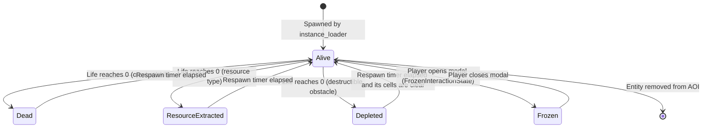

# Entity Profile

**Module:** `src/api/cyberia-entity` · `src/api/cyberia-instance-conf`

---

## Overview

An **Entity** is any object in the Cyberia Online game world — players, bots, NPCs, resource nodes, terrain tiles, portals, and skill-spawned projectiles. Every entity is represented as an ordered stack of **Object Layer** item IDs, a position on the grid, a type discriminator, and a runtime state.

---

## CyberiaEntity Schema (MongoDB)

```
CyberiaEntity {
  entityType:         String  // see Entity Type Registry below
  initCellX:          Number  // initial grid column
  initCellY:          Number  // initial grid row
  dimX:               Number  // width in cells (default: 1)
  dimY:               Number  // height in cells (default: 1)
  color:              String  // RGBA fallback color (no active OL texture)
  objectLayerItemIds: [String] // ordered list of ObjectLayer item IDs
  portalSubtype:      String  // portal only: inter/intra fixed or random mode
  respawnDurationMs:  Number  // wait after death, or after a loot token is consumed (min 1000, default 3000)

  // Bot-specific (ignored for non-bot entities)
  spawnRadius:  Number  // max wander / respawn radius in cells
  aggroRange:   Number  // optional attack-range override in cells
  maxLife:      Number  // maximum HP (0 = immortal)
  lifeRegen:    Number  // HP regeneration per tick
}
```

---

## Entity Type Registry

| `entityType`   | Behavior                      | Map-placed | Description                                           |
| -------------- | ----------------------------- | ---------- | ----------------------------------------------------- |
| `player`       | interactive                   | no         | Local (self) player                                   |
| `other_player` | interactive                   | no         | Remote players in AOI                                 |
| `bot`          | `hostile` / `passive`         | yes        | AI-controlled bot                                     |
| `skill`        | `skill`                       | no         | Runtime-spawned projectile (created by skill system)  |
| `coin`         | `coin`                        | no         | Runtime-spawned collectible (dropped on entity death) |
| `floor`        | static                        | yes        | Terrain tile (walkable)                               |
| `obstacle`     | static / `destructible`       | yes        | Collision tile (blocks movement)                      |
| `portal`       | static                        | yes        | Zone transition trigger                               |
| `foreground`   | static / `overhead-occlusion` | yes        | Foreground decoration layer, drawn over every entity  |
| `resource`     | extractable                   | yes        | Exploitable world object (drops items on extraction)  |

---

## Runtime PlayerState (Go)

```go
type PlayerState struct {
    ID                string             // Go server player UUID
    MapCode           string             // current map
    Pos               Point              // world position (float64 X, Y)
    Dims              Dimensions         // entity size
    Color             ColorRGBA          // fallback solid color
    Direction         Direction          // UP, UP_RIGHT, RIGHT, DOWN_RIGHT, DOWN, DOWN_LEFT, LEFT, UP_LEFT, NONE
    Mode              ObjectLayerMode    // IDLE, WALKING, TELEPORTING
    ObjectLayers      []ObjectLayerState // active OL stack: { ItemID, Active, Quantity }
    MaxLife           float64
    Life              float64
    LifeRegen         float64
    Coins             uint32             // flat coin balance (single source of truth)
    Frozen            bool               // FrozenInteractionState active
    FreezeReason      string             // "dialogue" | "inventory" | ...
    Path              []PointI           // A* path (for smooth movement)
    AOI               Rectangle          // current area-of-interest bounds
    Progression       EntityProgression  // level, total XP, and progression freeze
}
```

---

## ObjectLayer State

Each entity carries an ordered stack of `ObjectLayerState` entries:

```go
type ObjectLayerState struct {
    ItemID   string  // references ObjectLayer.data.item.id
    Active   bool    // equipped/activated (only activable types can be true)
    Quantity int     // inventory quantity (for stackable items)
}
```

The **active layers** determine the entity's rendered appearance and mechanical stats. The `Active` field is managed by the equipment rules.

---

## Equipment Rules

Equipment rules govern which item types may be simultaneously active on a character:

```javascript
EQUIPMENT_RULES_DEFAULTS = {
  activeItemTypes: ['skin', 'breastplate', 'weapon'], // only these types may be activated
  onePerType: true, // at most one active item per type
  requireSkin: true, // player must always have an active skin if they own any
};
```

**Validation on `item_activation` request:**

1. Reject if `item.type` not in `activeItemTypes`.
2. If `onePerType`, deactivate any currently active item of the same type before activating the new one.
3. If `requireSkin`, ensure a skin remains active after the change.

---

## Z-Order Rendering

The C client composites layers bottom-to-top by `item.type`:

```
z-order  type
──────   ───────────────────
  0      floor / obstacle / portal / foreground
  1      skin  (base character body)
  2      breastplate (armor overlay)
  3      weapon (weapon overlay)
```

`get_priority_for_type()` in `entity_render.c` maps item type → z-order integer. Multiple layers of the same type are rendered in declared order within that z-level.

---

## Stat Aggregation

Players, bots, NPCs, and resources share the same progression and stat module.
Bots, NPCs, and resources have frozen XP. Their authored level selects the same base curve as players.

```text
Effective = max(floor, Base(Level) + ActiveOL + Temporary)
```

Each active layer with positive quantity contributes once. Each OL stat is an integer in `[-100, +100]`.
The server applies floors after the full sum. Equipment rules control active slots and item types.

The self snapshot carries `level`, `xp`, `levelXp`, `nextLevelXp`, and four stat arrays.
Other living entities carry `level` and `effectiveStats`. `statsSum` is an uncapped display summary.
The overhead HUD and the Stats tab display the server values. XP and level never belong to `data.stats`.

---

## Entity Status Indicator (ESI)

The Go server computes a status `u8` per entity each AOI tick. The C client renders the corresponding icon above the entity nameplate.

```go
// Status constants (entity_status.go) — MUST stay in sync with JS STATUS_ICONS array
StatusNone              = 0  // skill/coin bots, world objects
StatusPassive           = 1  // passive bot
StatusHostile           = 2  // hostile bot
StatusFrozen            = 3  // player in FrozenInteractionState
StatusPlayer            = 4  // normal alive player
StatusDead              = 5  // dead / respawning entity
StatusResource          = 6  // static exploitable resource
StatusResourceExtracted = 7  // depleted resource (respawning)
StatusActionProvider    = 8  // NPC with available actions (bouncing chat icon)
```

---

## Per-EntityType Defaults

Every entity type resolves against a default build. The foundation baseline supplies one per entity
type ([Content artifact](content-artifact.md#document-families)); an instance conf references
`CyberiaEntityTypeDefault` documents that replace the baseline for the types they cover:

| Field               | Description                                                                                                                                                                  |
| ------------------- | ---------------------------------------------------------------------------------------------------------------------------------------------------------------------------- |
| `liveItemIds`       | ObjectLayer item IDs applied when entity is alive with no explicit items assigned                                                                                            |
| `deadItemIds`       | ObjectLayer item IDs for dead/ghost/respawning state                                                                                                                         |
| `dropItemIds`       | Items scattered on death as tokens the damage contributors race to collect                                                                                                   |
| `inventoryItemsIds` | Items the entity carries that no lifecycle state activates                                                                                                                   |
| `behavior`          | Runtime behavior of a bot: passive, hostile, provider or provider-static. Of a foreground: overhead-occlusion. Of an obstacle: destructible. Of loot: consume-on-pickup-heal |

A map save links each default whose live items the map places to every instance that runs the map,
unless another instance references that default. The instance editor's sync does the same for a whole
instance. A default that no instance references reaches no world.

---

## Bot Entity Profile

Bot entities extend the base schema with runtime AI state:

```go
type BotState struct {
    // Inherits all PlayerState fields
    Behavior      string     // "hostile" | "passive" | "skill" | "coin"
    SpawnRadius   int        // wander / respawn radius
    AggroRange    int        // attack range (0 = passive)
    SpawnPoint    PointI     // original spawn cell
    RespawnTimer  time.Time  // next respawn timestamp
}
```

**Bot behaviors:**

| Behavior  | AI Actions                              | Description              |
| --------- | --------------------------------------- | ------------------------ |
| `hostile` | pathfind to player, attack              | Aggressive enemy bot     |
| `passive` | random wander                           | Non-aggressive world NPC |
| `skill`   | move in direction, despawn on collision | Projectile entity        |
| `coin`    | static, collectible                     | Coin drop entity         |

**Foreground behaviors:**

A foreground behavior is presentation only. The server sends it in the snapshot, and the client runs it.

| Behavior             | Client action                                                                                                             |
| -------------------- | ------------------------------------------------------------------------------------------------------------------------- |
| (empty)              | Normal: drawn at full opacity over every entity                                                                           |
| `overhead-occlusion` | Roof: fades to the hidden opacity while the centre of the local player is inside it, and back to 1 when the player leaves |

The client hints `overheadOcclusionHiddenOpacity` (default `0`, the roof disappears) and `overheadOcclusionFadeMs`
(default `300`) set the hidden opacity and the fade duration.

---

## Resource Entity Profile

Resource entities have a specific lifecycle:

```
Alive (StatusResource)
  → Projectile damage brings life to 0
    → dropItemIds scatter as tokens the damage contributors race to collect
    → Objective XP goes to each player with a large enough damage share
    → Entity transitions to StatusResourceExtracted
      → Respawn timer starts
        → Entity returns to StatusResource
```

The respawn timer of a bot, a resource or a destructible obstacle is the `respawnDurationMs` of its
map entity, set in the Paint tab of the map editor. A player waits the default 3000 ms.

---

## Destructible Obstacle Profile

An obstacle whose entity-type default binds `destructible` shares the resource damage and drop
path, and keeps the obstacle rules for collision:

```
Alive (blocks its cells, sends life and maxLife)
  → Projectile damage brings life to 0
    → dropItemIds scatter as tokens the damage contributors race to collect
    → deadItemIds replace the live items; with none, the client draws nothing
    → The cells become walkable
      → Respawn timer starts, the same timer as a resource
        → Once no player or bot stands in the cells, the obstacle returns and blocks them again
```

- The behavior binds only when the obstacle carries every `liveItemIds` of the most specific
  default it matches. An obstacle that matches no default stays ordinary, whatever the first
  obstacle default binds.
- Life is the `maxLife` of the placed map entity, else `entityBaseMaxLife`. Obstacle stats stay
  zero and an obstacle has no level.
- A depleted obstacle earns no XP and grants no quest credit.
- An ordinary obstacle sends `maxLife` 0, takes no damage and never stops blocking.
- A world reload restores every obstacle, as it restores every resource.

---

## World Loot and Consumables

A consumable heals its `resistance` stat as life, never past `maxLife`. The green "+N" shows the life
it restored. Two paths consume one, and both apply the same server effect:

| Path           | Trigger                                                              | Unit spent                             |
| -------------- | -------------------------------------------------------------------- | -------------------------------------- |
| World loot     | A collector that misses life reaches a token that consumes on pickup | The token; nothing enters an inventory |
| Zero-waste use | The missing life of a holder takes the whole heal of a held unit     | One unit of the stack                  |

A world loot token shows one item, bound or not; an item without a render draws the `LOOT` colour. It
is collectable at once, blocks nothing and goes to the first living, unfrozen player or loot-collecting
bot on it. The `loot` entity-type default its item matches decides what collecting it does:
`consume-on-pickup-heal` consumes it, no behavior grants it to the inventory. A collector at full life
keeps the item of a consuming token, with the same pickup animation as any granted loot.

A skill document links a consumable to the `zero-waste-auto-consume-heal` logic, the way the coin
links to `coin_drop_or_transaction`. The skill summons the consumable itself. It is a held skill: the
server runs it every tick on each stack a player or loot-collecting bot holds, active or not, and a
tap never fires it.

```
World build (every map, every build)
  → each `loot` entity the map places becomes a token on its cell; a map holds no other world loot
Collected consuming token
  → back on its cell after the respawnDurationMs of its map entity
Held unit (each tick)
  → consumed once maxLife − life ≥ its heal and the consume cooldown is over
Any consumption
  → item_consume { entityId, itemId, behavior } goes to every viewer;
    consume-on-pickup-heal plays the green heal aura on the consumer
```

- A map places loot as a `loot` entity in the Paint tab of the map editor: one item, one cell, and
  its respawn time.
- The foundation baseline supplies the loot default of `consumable.med-gel`, which consumes on
  pickup, to a world that references no loot default.
- A granted token of an item that never consumes does not come back. A token that shows more than one
  item is skipped and logged.
- A consumption starts the consume cooldown, timed by the action cooldown rule and sent as
  `self.consumeReadyInMs`.
- Death drops keep their rules: only damage contributors collect them, after the launch window, and
  they expire after 45 seconds.

---

## Entity Lifecycle Diagram



---

## Coin Balance Architecture

Coins use a **flat + display split** design to avoid O(N) inventory traversal:

| Field                         | Type               | Purpose                                                                                            |
| ----------------------------- | ------------------ | -------------------------------------------------------------------------------------------------- |
| `entity.Coins`                | `uint32`           | **Single source of truth** — all economy operations read/write this field O(1)                     |
| `coinItemId ObjectLayer slot` | `ObjectLayerState` | **Display only** — `Active: false`, `Quantity = Coins`, synced by `syncCoinOL()` on every mutation |

The `coin` item type is never activable. The inventory UI automatically renders it with a lock indicator.
